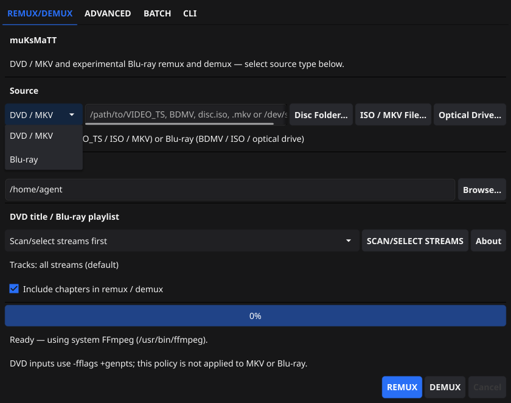

[README.md](https://github.com/user-attachments/files/34453918/README.md)
# muKsMaTT

**DVD & Blu-ray remuxing, demuxing, and track management — in a desktop GUI or straight from your terminal.**

muKsMaTT is a Linux media utility for exploring DVD titles and Blu-ray playlists, inspecting their tracks, and choosing what to keep. **REMUX** supported streams into MKV or M2TS, or **DEMUX** video, audio, and subtitles into separate files. Its interface is built with **Go and Fyne**; the media workflows use FFmpeg and stream copying where supported, without unnecessary re-encoding.

### !!everything has been tested, except DVD and Bluray decryption. i would really appreciate help testing on DVD/BD rom, encrypted physical disks!!

**Current version:** **[v0.0.3](https://github.com/maas3n/muKs/releases/tag/v0.0.3)** · **Linux x86-64 (amd64)** · Pre-release

<a href="docs/screenshots/source-menu.png">
  
</a>

## Features

- **DVD and Blu-ray:** Open DVD ISO images, `VIDEO_TS` folders, and supported drives; inspect Blu-ray `BDMV` sources, supported ISOs, and accessible drives.
- **REMUX / DEMUX:** Preserve supported original video/audio/subtitle tracks, choose stream indexes, and export chapter information where available.
- **ADVANCED workspace:** Choose individual tracks for muxing or demuxing. DVD DEMUX reads the disc directly — **no intermediate MKV**.
- **Batch workflow:** Remux collections of DVD inputs to MKV with optional logging.
- **Real terminal CLI:** Run every CLI command through the standalone executable; the GUI's **CLI** tab provides convenient presets but is not required.
- **Self-extracting standalone:** A Linux executable with bundled media tools, plus Debian, portable, and source distributions.

## Download and installation

All files are published under **[v0.0.3 on GitHub Releases](https://github.com/maas3n/muKs/releases/tag/v0.0.3)**.

| Distribution | Download |
| --- | --- |
| **Linux standalone (recommended)** | [muKsMaTT-0.0.3-Linux-amd64Standalone](https://github.com/maas3n/muKs/releases/download/v0.0.3/muKsMaTT-0.0.3-Linux-amd64Standalone) |
| Debian / Ubuntu | [`.deb`](https://github.com/maas3n/muKs/releases/download/v0.0.3/muKsMaTT-0.0.3-Linux-amd64.deb) |
| Portable Linux | [`.tar.gz`](https://github.com/maas3n/muKs/releases/download/v0.0.3/muKsMaTT-0.0.3-Linux-amd64.tar.gz) |
| Application source | [Source `.tar.gz`](https://github.com/maas3n/muKs/releases/download/v0.0.3/muKsMaTT-0.0.3-Source.tar.gz) |
| Bundled library sources | [Library sources `.tar.gz`](https://github.com/maas3n/muKs/releases/download/v0.0.3/muKsMaTT-0.0.3-Linux-Library-Sources.tar.gz) |
| Development bundle | [Development `.zip`](https://github.com/maas3n/muKs/releases/download/v0.0.3/muKsMaTT-0.0.3-Linux-amd64-dev.zip) |
| Checksums | [`SHA256SUMS.txt`](https://github.com/maas3n/muKs/releases/download/v0.0.3/SHA256SUMS.txt) |

```bash
# curl
curl -fLO 'https://github.com/maas3n/muKs/releases/download/v0.0.3/muKsMaTT-0.0.3-Linux-amd64Standalone'

# wget (alternative)
wget 'https://github.com/maas3n/muKs/releases/download/v0.0.3/muKsMaTT-0.0.3-Linux-amd64Standalone'
```

</details>

### Verify and launch

Check the standalone download before executing it. Its **v0.0.3 SHA-256** is:

```text
c15c5861a6f84e8ec8a71649e569fd25304a5f73eab161ded42880c8c5b94ba9
```

```bash
echo 'c15c5861a6f84e8ec8a71649e569fd25304a5f73eab161ded42880c8c5b94ba9  muKsMaTT-0.0.3-Linux-amd64Standalone' | sha256sum -c -
chmod +x ./muKsMaTT-0.0.3-Linux-amd64Standalone

# Start the graphical application
./muKsMaTT-0.0.3-Linux-amd64Standalone

# Or run the CLI directly, without opening the GUI
./muKsMaTT-0.0.3-Linux-amd64Standalone --help
```

The standalone bundles media-processing tools, but the GUI still needs compatible Linux graphics and runtime libraries.

## The graphical interface

| Tab | Purpose |
| --- | --- |
| **REMUX/DEMUX** | Scan a source, inspect titles and tracks, then remux or extract streams. |
| **ADVANCED** | Select streams individually, demux DVD tracks, or mux compatible tracks from different sources. |
| **BATCH** | Process multiple DVD movies without repeating the operation manually. |
| **CLI** | Run and adapt built-in examples for DVD and Blu-ray commands. |

The CLI tab is **optional**. The standalone accepts CLI commands directly: `./muKsMaTT-0.0.3-Linux-amd64Standalone COMMAND ...`.

## Command-line quick start

For the examples below, set a shell shortcut and create an output folder:

```bash
APP='./muKsMaTT-0.0.3-Linux-amd64Standalone'
mkdir -p './output'
```

Change the sample paths and title/playlist numbers to match your disc. Run `scan` or `tracks` / `metadata` before selecting streams. **All commands below use the terminal directly; no GUI or `--cli` prefix is necessary.**

### DVD — scan, remux, demux

```bash
# Discover DVD titles (the longest is marked)
muksmatt scan '/path/to/DVD.iso/DVDdrive/or/folder'

# Inspect the streams and chapters in title 1
muksmatt metadata --title 1 '/path/to/DVD.iso/DVDdrive/or/folder'

# REMUX title 1 into MKV (REMUX/DEMUX workflow)
muksmatt remux --title 1 --output '/output/folder' '/path/to/DVD.iso/DVDdrive/or/folder'

# DEMUX selected streams directly (REMUX/DEMUX implementation)
muksmatt demux --title 1 --output '/output/folder' '/path/to/DVD.iso/DVDdrive/or/folder'

# DEMUX directly with the ADVANCED implementation
muksmatt advanced demux --title 1 --output '/output/folder' '/path/to/DVD.iso/DVDdrive/or/folder'
```

To demux specific tracks, export VOB video, or omit chapters:

```bash
muksmatt demux --title 1 --streams 0,1,2 --output '/output/folder' '/path/to/DVD.iso/DVDdrive/or/folder'
muksmatt advanced demux --title 1 --video vob --output '/output/folder' '/path/to/DVD.iso/DVDdrive/or/folder'
muksmatt demux --title 1 --no-chapters --output '/output/folder' '/path/to/DVD.iso/DVDdrive/or/folder'
```

Both DVD DEMUX modes use the existing extraction paths without generating an intermediate MKV. DVD REMUX, by contrast, intentionally produces an MKV.

### Blu-ray — scan, remux, demux

```bash
# Discover Blu-ray playlists; pick the correct playlist ID
muksmatt bluray scan '/path/to/BDMV/ISO/OR/DRIVE'

# Inspect video/audio/subtitle streams in playlist 00800
muksmatt bluray tracks --playlist 00800 '/path/to/BDMV/ISO/OR/DRIVE'

# REMUX playlist 00800 to MKV, preserving compatible streams
muksmatt bluray remux --playlist 00800 --output '/output/folder/movie.mkv' '/path/to/BDMV/ISO/OR/DRIVE'

# REMUX to M2TS instead (no chapters; compatible video/audio/PGS)
muksmatt bluray remux --playlist 00800 --output '/output/folder/movie.m2ts' '/path/to/BDMV/ISO/OR/DRIVE'

# DEMUX into elementary video, audio and subtitle tracks
muksmatt bluray demux --playlist 00800 --output '/output/folder' '/path/to/BDMV/ISO/OR/DRIVE'

# Also available: video-only M2TS, or BOTH native video + M2TS
muksmatt bluray demux --playlist 00800 --video m2ts --output '/output/folder' '/path/to/BDMV/ISO/OR/DRIVE'
muksmatt bluray demux --playlist 00800 --video both --output '/output/folder' '/path/to/BDMV/ISO/OR/DRIVE'
```

Some Blu-ray discs contain misleading or looping playlists, so **scan and specify `--playlist`** rather than assuming the longest is the correct movie. Protected Blu-rays require correctly configured AACS/BD+ support.

### Batch and utilities

```bash
# Batch-remux supported DVD movies in a collection
muksmatt --batch '/path/to/DVD-collection' '/output/folder'

# Same batch operation with an appended activity log
muksmatt --batch --log '/output/folder/batch.log' '/path/to/DVD-collection' '/output/folder'

# Version, command help, resolved tools and diagnostics
muksmatt --version
muksmatt --help
muksmatt tools
muksmatt doctor

# Test extraction/availability of the standalone's bundled runtime
muksmatt --standalone-self-test
```

## Full CLI reference — commands, flags and defaults

The tables below document **all supported application-level flags** in v0.0.3, organized by command. Use `--help` for the overall CLI overview or `COMMAND --help` for individual flag help. `SOURCE` is a required positional argument except where a command's syntax says otherwise.

### Commands at a glance

| Area | Commands | What they do |
| --- | --- | --- |
| DVD | `scan`, `metadata`, `remux` | Find titles, inspect tracks, remux into MKV. |
| DVD DEMUX | `demux`, `advanced demux` | Two direct-extraction workflows with different output organization. |
| Blu-ray | `bluray scan`, `bluray tracks` | Discover playlists and inspect streams. |
| Blu-ray aliases | `bluray metadata`, `bluray info` | Same operation as `bluray tracks`. |
| Blu-ray processing | `bluray remux`, `bluray demux` | MKV/M2TS remuxing or separate stream extraction. |
| Batch | `--batch` | DVD collection-to-MKV processing. |
| Diagnostics | `tools`, `doctor`, `--help`, `--version`, `--standalone-self-test` | Help, versions, media tools, self-test. |

<details>
<summary><strong>DVD command syntax and every DVD flag</strong></summary>

| Command | Syntax |
| --- | --- |
| Scan | `scan SOURCE` |
| Metadata | `metadata [--title N] SOURCE` |
| REMUX | `remux [--title N] [--output DIR] [--streams 0,1,2] [--no-chapters] SOURCE` |
| DEMUX (main) | `demux [--title N] [--output DIR] [--streams 0,1,2] [--video mpeg2\|vob] [--no-chapters] SOURCE` |
| DEMUX (ADVANCED) | `advanced demux [--title N] [--output DIR] [--streams 0,1,2] [--video mpeg2\|vob] [--no-chapters] SOURCE` |

| Option | Applies to | Default / behavior |
| --- | --- | --- |
| `--title N` | `metadata`, `remux`, `demux`, `advanced demux` | `0` or omitted: automatically select longest DVD title. Positive number: explicit title. |
| `--output DIR` | `remux`, both DEMUX commands | If omitted, output goes beside the ISO/`VIDEO_TS` source (for folder sources, see CLI path resolution). **Required for physical DVD drives.** DEMUX creates the destination directory if needed, provided the location is writable. |
| `--streams 0,1,2` | `remux`, both DEMUX commands | Omitted: all applicable streams. Values are **absolute, nonnegative indexes** as reported by DVD metadata. |
| `--video mpeg2` | Both DEMUX commands only | Default: export elementary MPEG-2 video. |
| `--video vob` | Both DEMUX commands only | Export video in `.VOB` format. |
| `--no-chapters` | `remux`, both DEMUX commands | Omitted: preserve/export available chapter information. Flag set: skip chapters. |
| `--help` | Individual subcommand | Show the command's flag help where supported. |

`scan` accepts no operation-specific flags. `metadata` accepts `--title` only. **Do not use `--video` with DVD `remux`** — it is a DEMUX-only option.

**DVD sources:** supported DVD ISO, DVD directory / `VIDEO_TS`, or accessible physical optical drive such as `/dev/sr0`. If reading a physical drive, always supply `--output DIR`.

</details>

<details>
<summary><strong>Blu-ray command syntax and every Blu-ray flag</strong></summary>

| Command | Syntax |
| --- | --- |
| Scan | `bluray scan BLURAY_SOURCE` |
| Tracks | `bluray tracks --playlist 00800 BLURAY_SOURCE` |
| Tracks aliases | `bluray metadata --playlist 00800 BLURAY_SOURCE` or `bluray info --playlist 00800 BLURAY_SOURCE` |
| REMUX to MKV | `bluray remux [--playlist 00800] --output MOVIE.mkv [--streams 0,1] [--no-chapters] BLURAY_SOURCE` |
| REMUX to M2TS | `bluray remux [--playlist 00800] --output MOVIE.m2ts [--streams 0,1] [--no-chapters] BLURAY_SOURCE` |
| DEMUX | `bluray demux --playlist 00800 --output DIR [--streams 0,1,9] [--video elementary\|m2ts\|both] [--no-chapters] BLURAY_SOURCE` |

| Option | Applies to | Default / behavior |
| --- | --- | --- |
| `--playlist 00800` | `bluray tracks` (and aliases), `bluray remux`, `bluray demux` | **Required** for tracks/DEMUX. Optional for REMUX (omitting selects the longest playlist, which may be a decoy). Preserve leading zeros. |
| `--output FILE.mkv` | `bluray remux` | **Required** destination file; muxes compatible tracks into an MKV. |
| `--output FILE.m2ts` | `bluray remux` | **Required** destination file; M2TS contains compatible video/audio/PGS, **no chapters**, and does not support text subtitles in this mode. |
| `--output DIR` | `bluray demux` | **Required writable destination directory**; muKsMaTT creates it if necessary, then writes separate stream files into a new subfolder. |
| `--streams 0,1,9` | `bluray remux`, `bluray demux` | Omitted: all applicable streams. Uses absolute track indexes from `bluray tracks`. |
| `--video elementary` | `bluray demux` only | Default: video as native elementary stream(s), with separately extracted audio/subtitle files. |
| `--video m2ts` | `bluray demux` only | Video-only M2TS plus separate audio/subtitle files. |
| `--video both` | `bluray demux` only | Both native elementary video and video-only M2TS, plus separate audio/subtitle files. |
| `--no-chapters` | `bluray remux`, `bluray demux` | Omit chapter information. M2TS REMUX omits chapters regardless. |
| `--help` | Individual subcommand | Show the command's flag help where supported. |

`bluray scan` has no operation-specific flags. `bluray tracks`, `bluray metadata`, and `bluray info` accept only `--playlist`. **`--video` applies to Blu-ray DEMUX, not REMUX** — the REMUX output extension determines MKV versus M2TS.

**Blu-ray sources:** `BDMV` directory, supported Blu-ray ISO, or accessible disc drive. AACS/BD+ protected sources require appropriate key support. Playlist `00800` is an example, not a universal title number.

**Additional examples:**

```bash
# Tracks command aliases
muksmatt bluray metadata --playlist 00800 '/path/to/BDMV/ISO/OR/DRIVE'
muksmatt bluray info --playlist 00800 '/path/to/BDMV/ISO/OR/DRIVE'

# REMUX a subset of streams to MKV without chapters
muksmatt bluray remux --playlist 00800 --streams 0,1 --no-chapters \
  --output '/output/folder/movie.mkv' '/path/to/BDMV/ISO/OR/DRIVE'

# DEMUX specific tracks as elementary streams, without chapters
muksmatt bluray demux --playlist 00800 --streams 0,1,9 --video elementary \
  --no-chapters --output '/output/folder' '/path/to/BDMV/ISO/OR/DRIVE'
```

</details>

<details>
<summary><strong>Batch, utility commands and global options</strong></summary>

| Command / option | Syntax | Behavior |
| --- | --- | --- |
| Batch | `--batch [--log FILE] MOVIES_ROOT [OUTPUT_ROOT]` | Find eligible DVD movie folders and ISO files in the chosen root (including ISOs one folder down), then remux longest titles to MKV. |
| `--log FILE` | With `--batch` only | Optional; creates parent log folders if needed, and **appends** to the log file. |
| `MOVIES_ROOT` | With `--batch` | Required input root containing DVD movie folders / ISO files. |
| `OUTPUT_ROOT` | With `--batch` | Optional; if omitted, write each resulting MKV beside its source. |
| Help | `--help` | Print supported commands and usage. |
| Version | `--version` | Print CLI version. |
| Tools | `tools` | Show resolved FFmpeg and FFprobe paths. |
| Doctor | `doctor` | Same tool-resolution diagnostic as `tools`. |
| Standalone self-test | `--standalone-self-test` | Check the self-extracting standalone runtime. |
| Compatibility mode | `--cli COMMAND ...` | Also works on the standalone, but **is not required** for normal terminal commands. |

Batch mode looks for `VIDEO_TS` movie folders directly inside `MOVIES_ROOT`, plus ISO files in the root or one folder below. It is **not an unrestricted recursive directory scan**. It chooses the longest title for each discovered movie and remuxes its streams to MKV. The CLI uses compatible FFmpeg/FFprobe executables from `PATH` when possible, with a fallback for DVD-Video support.

For individual flag help, for example:

```bash
muksmatt demux --help
muksmatt advanced demux --help
muksmatt bluray remux --help
muksmatt bluray demux --help
muksmatt --help
```

</details>

## Changes in v0.0.3

- Added direct-terminal **DVD `demux`** and **`advanced demux`** commands, using their existing REMUX/DEMUX and ADVANCED engines.
- Added matching DVD DEMUX examples to the in-app CLI tab.
- Preserved existing DVD REMUX, Blu-ray commands, batch processing, and standalone terminal support.
- Retained the v0.0.2 fix limiting **DVD MUX to MKV**, rather than M2TS, in the ADVANCED tab.
- Preserved existing FFmpeg/media-processing engine code and bundled media libraries.

The v0.0.3 release is a **pre-release**. Refer to [release notes](https://github.com/maas3n/muKs/releases/tag/v0.0.3) for the published asset list and changes.

## Support muKsMaTT

If muKsMaTT is useful to you and you'd like to support its development, Bitcoin donations are appreciated but entirely optional.

 **BTC:** `bc1q79hj2zukfmm75278a7wssjmexanuhvs5nequel`


## Checksums, license and project links

- [v0.0.3 release and downloads](https://github.com/maas3n/muKs/releases/tag/v0.0.3)
- [SHA256SUMS.txt](https://github.com/maas3n/muKs/releases/download/v0.0.3/SHA256SUMS.txt) — verify packages before installing or running.
- [Repository](https://github.com/maas3n/muKs)
- [License](https://github.com/maas3n/muKs/blob/main/LICENSE)

---

*Use muKsMaTT with discs and content you are legally permitted to process.*
